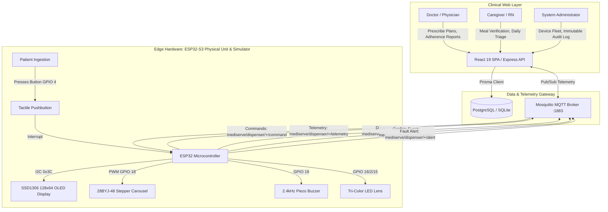

# MediServe – Smart Medication Dispensing & Patient Monitoring System

MediServe is an IoT hardware device (ESP32) and clinical web platform engineered to help patients—especially elderly individuals managing multi-medication chronic regimens—avoid missed doses, eliminate double-dosing hazards, and maintain rigorous physician oversight.

> **Important Clinical & Regulatory Notice:**  
> This software is a high-fidelity working prototype and clinical monitoring architecture. It **does not** prescribe or auto-adjust medications, nor does it replace professional physician judgment. Before any real-world patient deployment, the system requires formal medical-device regulatory evaluation (FDA 510(k) / CE MDR Class IIa), IEC 62304 clinical software lifecycle compliance, and legal review under applicable healthcare privacy statutes (including India's Digital Personal Data Protection Act, 2023 and HIPAA).

---

## Table of Contents
1. [Non-Negotiable Medical Safety Rules](#1-non-negotiable-medical-safety-rules)
2. [End-to-End System Architecture](#2-end-to-end-system-architecture)
3. [Roles & Access Control](#3-roles--access-control)
4. [Hardware Platform & ESP32 Firmware](#4-hardware-platform--esp32-firmware)
5. [Local Development & Quick Start](#5-local-development--quick-start)
6. [Docker Compose Multi-Container Deployment](#6-docker-compose-multi-container-deployment)
7. [Device Simulator & Hardware Emulation](#7-device-simulator--hardware-emulation)
8. [Automated Verification & Test Matrix](#8-automated-verification--test-matrix)
9. [Monorepo Architecture & Mobile Application](#9-monorepo-architecture--mobile-application)
10. [Regulatory & DPDP Act 2023 Alignment](#10-regulatory--dpdp-act-2023-alignment)

---

## 1. Non-Negotiable Medical Safety Rules

The MediServe engine strictly enforces six foundational healthcare safety rules across data models, hardware firmware, and clinical user interfaces:

1. **State Segregation (Dispensing $\neq$ Swallowing):**  
   A compartment opening or motor rotation is **never** proof that the patient swallowed their medicine. States are strictly segregated across the data layer, API, and UI:
   $$\text{Reminder Sent} \longrightarrow \text{Dispensing Attempted} \longrightarrow \text{Patient Confirmed} \longrightarrow \text{Verified Ingestion (Observer)} \mid \text{Missed / Needs Review}$$
   Never collapse these into a single "taken" status.
2. **Physician-Only Prescriptions (Zero AI Dosing):**  
   The system **never** prescribes, auto-adjusts, or modifies dosages or schedules via AI. Only authorized physicians (`DOCTOR` role) can author or alter prescriptions. Every mutation records who, when, old value, and new value in the immutable audit log (`AuditLog`).
3. **Never Suggest Doubling Doses:**  
   If a dose is missed or delayed, the system alerts the care team; it **never** instructs the patient or caretaker to take two doses at the next interval.
4. **Meal-Aware Eligibility:**  
   Doses with meal dependencies (`AFTER_MEAL`, `WITH_MEAL`, `EMPTY_STOMACH`) require affirmative human verification (`REPORTED` or `CONFIRMED`). Passive sensor readings (`SENSOR_DETECTED`) **never** unlock medication without caregiver/patient verification.
5. **Idempotency & Monotonic Deduplication:**  
   Every dose has a deterministic identifier (`ME-YYYYMMDD-HHMM-NNN`). Write operations (dispense, confirm, telemetry ingest, alerts) are idempotent to prevent duplicate releases from network retries.
6. **Hardware Fail-Safe Overrides & Recovery Flow:**  
   When a mechanical jam (`JAMMED`), optical beam occlusion (`SENSOR_ERROR`), or battery loss occurs, the device immediately halts motor drive, sounds an audible alert, and transitions the event to `NEEDS_REVIEW`. Caregivers utilize an assisted recovery workflow to inspect the chamber and safely clear faults.
7. **Adherence Math Formula:**  
   $$\text{Adherence Rate} = \left(\frac{\text{Eligible Doses Recorded as Taken}}{\text{Total Eligible Scheduled Doses}}\right) \times 100$$
   Only `Patient Confirmed` and `Verified Ingestion` count toward the numerator. Unconfirmed doses are shown separately as not-taken-confirmed. Every report displays data completeness (% of doses with a finalized state).

---

## 2. End-to-End System Architecture



---

## 3. Roles & Access Control

The platform provides pre-seeded clinical personas for zero-config demonstration:

| Persona | Role | Seed Email | Password | Scope & Authority |
| :--- | :--- | :--- | :--- | :--- |
| **Noah Patel, RN** | `CAREGIVER` | `caregiver@mediserve.local` | `MediServe!23` | Patient profiles, meal logging, vital signs, alert triage, device pairing, and simulator controls |
| **Dr. Amrita Shah** | `DOCTOR` | `doctor@mediserve.local` | `MediServe!23` | Assigned cohort adherence analytics, prescription authoring, clinical notes, PDF/CSV report exports |
| **System Admin** | `ADMIN` | `admin@mediserve.local` | `MediServe!23` | Directory management, provider assignments, hardware fleet provisioning, immutable security audit log |

*(The login page at `http://localhost:3000/login` includes 1-click quick-login buttons for all roles).*

---

## 4. Hardware Platform & ESP32 Firmware

- **Source Code:** [`firmware/esp32_dispenser/mediserve_dispenser.ino`](file:///c:/Users/Ganesh/OneDrive/Desktop/3-2%20super%20prime/mediserve/firmware/esp32_dispenser/mediserve_dispenser.ino)
- **Wiring & BOM Guide:** [`docs/HARDWARE_WIRING.md`](file:///c:/Users/Ganesh/OneDrive/Desktop/3-2%20super%20prime/mediserve/docs/HARDWARE_WIRING.md)
- **Architecture Specification:** [`docs/ARCHITECTURE.md`](file:///c:/Users/Ganesh/OneDrive/Desktop/3-2%20super%20prime/mediserve/docs/ARCHITECTURE.md)
- **OpenAPI 3.0 Contract:** [`docs/OPENAPI.yaml`](file:///c:/Users/Ganesh/OneDrive/Desktop/3-2%20super%20prime/mediserve/docs/OPENAPI.yaml)

### Hardware Key Features:
- **Dual-Stack MQTT & HTTP:** Primary low-latency bidirectional communication over MQTT (`mediserve/dispenser/{serial}/*`) with fallback HTTP polling.
- **Offline Ring Buffer:** Buffers up to 32 dose and alert events in local memory during network outages, synchronizing chronologically upon reconnect.
- **Power Optimization:** Stepper motor driver coils are de-energized immediately after stepping to prevent heating and conserve battery life.

---

## 5. Local Development & Quick Start

### Prerequisites
- Node.js 18+ (Node 20 recommended)
- npm 9+

### 1. Installation
```bash
git clone <repo-url> mediserve
cd mediserve
npm install
```

### 2. Database Initialization
```bash
npx prisma db push
npx tsx prisma/seed.ts
```

### 3. Launch Development Servers
```bash
npm run dev
```
- **Web App (Vite):** [http://localhost:3000](http://localhost:3000)
- **Backend API (Express):** [http://localhost:3001](http://localhost:3001)
- **Hardware Simulator:** [http://localhost:3000/simulator](http://localhost:3000/simulator)

---

## 6. Docker Compose Multi-Container Deployment

MediServe includes a production-ready container stack running the Node.js API, PostgreSQL database, and Eclipse Mosquitto MQTT broker:

```bash
# Launch full multi-container stack
docker-compose up -d --build

# Verify container health
docker-compose ps
```

The stack provisions:
- `mediserve_api`: Express REST & WebSocket API on port `3001`
- `mediserve_postgres`: PostgreSQL 16 database on port `5432`
- `mediserve_mqtt`: Mosquitto MQTT broker on ports `1883` (TCP) and `9001` (WebSockets)

---

## 7. Device Simulator & Hardware Emulation

The **Dispenser Simulator** (`/simulator`) provides an end-to-end digital twin of the physical ESP32 device:
- **Realistic SSD1306 128x64 OLED Display:** Live real-time clock (`HH:MM:SS`), 4-bar WiFi RSSI, battery fuel gauge, and animated status screens (`STANDBY`, `MEDICATION DUE`, `MOTOR ROTATING`, `PILL IN TRAY`, `JAMMED`, `LOW BATTERY`).
- **Dual-Color Status LED Lens:** Green (Ready), Pulsing Amber (Due), Flashing Red (Fault), Slate (Offline).
- **Web Audio 2.4kHz Piezo Buzzer:** Realistic medical alarm beeps with mute/unmute toggle.
- **4-Slot Rotary Carousel Chamber:** Visual compartment stock tracking with manual 90° step and refill controls.
- **Tactile 3D Confirm Push Button:** Demonstrates patient dose confirmation with haptic visual feedback.
- **Live MQTT Gateway Inspector:** Real-time stream of all incoming/outgoing MQTT telemetry packets with topic filtering (`ALL`, `TELEMETRY`, `DISPENSE`, `CONFIRM`, `ALERT`), copy JSON, and clear controls.

---

## 8. Automated Verification & Test Matrix

The platform is backed by a 32-test automated test suite across 8 comprehensive suites:

```bash
npm test
```

### Verified Test Suites (32/32 Passing):
1. **MediServe /api/v1 REST Specification & Clinical Security Checklist:**
   - Checklist 1: Role-based authentication and route permissions (`CAREGIVER`, `DOCTOR`, `ADMIN`).
   - Checklist 2: Medication schedule creates unique deterministic dose records (`ME-YYYYMMDD-HHMM-NNN`).
   - Checklist 3 & 4: Correct compartment activates and resets on patient confirmation.
   - Checklist 5 & 6: Missed-dose alerts generated after deadline without duplicate notifications.
   - Checklist 7: Adherence report explicitly breaks down confirmed vs uncertain.
   - Checklist 8: Unified dose statuses across client gateways.
   - Checklist 9: Device events deduplicated by `eventId`.
   - Checklist 10: Schedule modification produces 21 CFR Part 11 audit log.
   - Section 13: Complete End-to-End Scenario (Create Schedule $\rightarrow$ Activate Dose $\rightarrow$ Confirm & Overdue Alert Escalation).
2. **Caregiver Flow Integration Test:** End-to-end caregiver path: meal recording $\rightarrow$ dose eligibility unlock $\rightarrow$ dispense cycle $\rightarrow$ patient confirmation.
3. **14 Routes Specification & Verification:** Full registration and export verification for all clinical routes and UI components (`OledSimulatorPanel`, `Shell`, `Panel`).
4. **Adherence Calculations Engine:** Factual calculations for adherence percentage, missed, delayed, and taken doses.
5. **Alerts & Notification Routing Engine:** 6-hour deduplication, multi-channel dispatch (In-App, Push, SMS, Email), and hardware fault triggers (`JAMMED`, `LOW_BATTERY`).
6. **Deterministic Event IDs:** Slot-based monotonic ID generation (`ME-YYYYMMDD-HHMM-NNN`).
7. **Meal-Aware Eligibility Engine:** Strict verification enforcement (ensuring passive sensor readings never unlock medication).
8. **Supabase Integration:** Client instantiation, environment configurations, and query builder verification.

---

## 9. Monorepo Architecture & Mobile Application

The codebase is organized as a unified monorepo providing complete separation of concerns and maximum code reusability:

- **`packages/shared-types`**: Authoritative domain models and enums (`DoseState`, `Role`, `DeviceEventType`, `Medication`, `ScheduledDose`, etc.).
- **`packages/validation`**: Runtime schema validators for schedules, confirmations, and hardware telemetry.
- **`packages/api-client`**: Isomorphic TypeScript client for `/api/v1` with token injection and automatic session handling.
- **`apps/mobile`**: React Native & Expo cross-platform mobile client featuring:
  - Caregiver and patient authentication with 21 CFR Part 11 notices.
  - IoT dispenser telemetry monitor (battery, WiFi RSSI, 4-slot carousel stock).
  - Next dose card with 1-tap patient confirmation.
  - Meal protocols & daily dosage timeline.
  - Critical alerts triage with 1-tap phone escalation.
  - Device fleet manager with hardware synchronization.
- **`server/v1/routes.ts`**: Complete `/api/v1` REST endpoints for authentication, patients, medications, schedules, doses, devices, adherence metrics, and audit logs.
- **`server/workers/doseReminderWorker.ts`**: Background scheduled dose processor and 15-minute overdue missed-dose escalation worker.

---

## 10. Regulatory & DPDP Act 2023 Alignment

1. **Consent & Purpose Limitation:** Caregiver and doctor access is strictly gated by an explicit, auditable `PatientAssignment` and consent record.
2. **Data Minimization:** No patient names, diagnoses, or clinical notes are ever broadcast over MQTT telemetry topics. Telemetry payloads contain only hardware serials, battery levels, sensor flags, and monotonic event IDs.
3. **Immutable Audit Trail:** All prescription updates, report exports, clinical notes, and alert acknowledgments write append-only records to `AuditLog`.
4. **Breach Notification & Governance:** Administrative access includes real-time device fleet health monitoring and instant device revocation.
