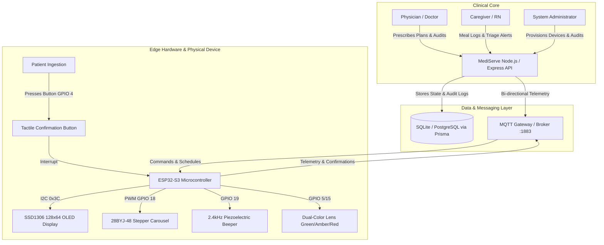
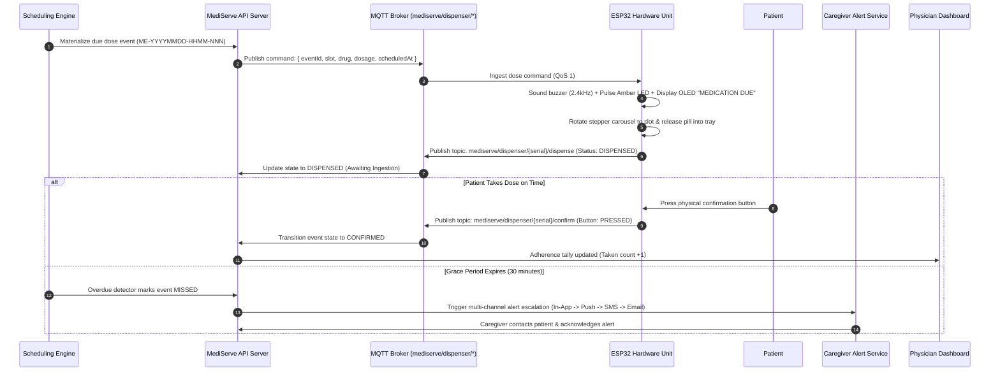

# MediServe Architecture & Systems Specification

## 1. System Overview

MediServe is an IoT hardware device (ESP32) and clinical web platform designed for elderly patients on multi-medication regimens. The system enforces non-negotiable healthcare safety rules, deterministic dose state progression, multi-channel alert escalation, and physician-reviewed adherence analytics.



---

## 2. Non-Negotiable Medical Safety Guardrails

1. **State Segregation (Dispense != Swallow):**
   A compartment opening or motor rotation is **never** proof that the patient swallowed their medicine. States are strictly segregated across the data layer, API, and UI:
   ```
   [SCHEDULED] ──► [REMINDER_SENT] ──► [DISPENSED] ──► [CONFIRMED] ──► [VERIFIED_INGESTION]
         │                │                 │
         └────────────────┴─────────────────┴───────► [MISSED / NEEDS_REVIEW]
   ```
2. **Physician-Only Prescribing (No AI Dosing):**
   Medication schedules and dosages can only be created or changed by authorized healthcare professionals (`DOCTOR` role). Every mutation records who, when, old value, and new value in the immutable audit log (`AuditLog`).
3. **Never Recommend Doubling Doses:**
   In the event of a missed dose or schedule delay, the platform alerts the caregiver/physician and explicitly directs the patient: *"Do not double or take extra doses. Contact your physician or care team."*
4. **Idempotency & Monotonic Deduplication:**
   Every dose has a deterministic identifier (`ME-YYYYMMDD-HHMM-NNN`). Write operations (dispense, confirm, event ingest, notifications) are idempotent to prevent duplicate releases during network retries.
5. **Hardware Fail-Safe Overrides & Recovery Flow:**
   When mechanical jam (`JAMMED`), sensor failure (`SENSOR_ERROR`), or battery loss occurs, the device halts motor drive, sounds an acoustic alarm, and transitions to `NEEDS_REVIEW`. Caregivers use a recovery workflow to inspect the chamber and reset safely.
6. **Adherence Formula:**
   $$\text{Adherence Rate} = \frac{\text{Eligible Doses Taken (Confirmed + Verified)}}{\text{Total Eligible Scheduled Doses}} \times 100$$
   Unconfirmed doses are counted as not-taken-confirmed and reported separately. Every report displays data completeness (% of doses with a finalized state).

---

## 3. Data Flow Diagram



---

## 4. Hardware Communication Protocol

### Topic Architecture
Base topic format: `mediserve/dispenser/{serial}/{action}`

| Topic | Direction | QoS | Description |
| :--- | :--- | :--- | :--- |
| `mediserve/dispenser/{serial}/command` | Cloud $\rightarrow$ Device | 1 | Dispense instructions, schedule sync, time calibration |
| `mediserve/dispenser/{serial}/telemetry` | Device $\rightarrow$ Cloud | 0/1 | Periodic heartbeats, battery %, RSSI, free heap, temperature |
| `mediserve/dispenser/{serial}/dispense` | Device $\rightarrow$ Cloud | 1 | Motor actuation result, compartment slot, IR drop count |
| `mediserve/dispenser/{serial}/confirm` | Device $\rightarrow$ Cloud | 1 | Physical tactile pushbutton press event with microsecond timestamp |
| `mediserve/dispenser/{serial}/alert` | Device $\rightarrow$ Cloud | 1 | Hardware fault notifications (`JAMMED`, `LOW_BATTERY`, `SENSOR_ERROR`) |

### Payload Schemas

#### 1. Dose Command (`/command`)
```json
{
  "command": "DISPENSE",
  "eventId": "ME-20261027-0900-001",
  "slot": 1,
  "medicationName": "Metformin 500mg",
  "dosage": "1 Tablet",
  "scheduledAt": "2026-10-27T09:00:00.000Z",
  "gracePeriodSec": 1800,
  "idempotencyKey": "idem-94819a84"
}
```

#### 2. Confirm Ingestion (`/confirm`)
```json
{
  "serial": "MS-DISP-A1",
  "eventId": "ME-20261027-0900-001",
  "button": "TACTILE_SWITCH_PRESSED",
  "verifiedAt": "2026-10-27T09:04:12.821Z",
  "status": "CONFIRMED",
  "slot": 1
}
```

#### 3. Fault Notification (`/alert`)
```json
{
  "serial": "MS-DISP-A1",
  "fault": "JAMMED",
  "slot": 2,
  "errorCode": "MOTOR_STALL_OCT_2",
  "batteryPct": 78,
  "timestamp": "2026-10-27T09:02:15.112Z"
}
```

### Offline Synchronization Rules
1. **Local Non-Volatile Storage (SPIFFS / EEPROM):** When Wi-Fi or MQTT disconnects, the ESP32 buffers up to 64 events locally with monotonic sequence numbers.
2. **On Reconnection:** The device transmits buffered messages in chronological order using their original timestamps.
3. **Deduplication:** The backend compares `eventId` and `idempotencyKey` against existing records. Repeated frames return status `200 OK` without duplicating database writes.

---

## 5. Security & DPDP Act 2023 Alignment

1. **Digital Personal Data Protection Act, 2023 (India):**
   - **Consent Verification:** Caregivers and physicians can only access patient data after an explicit consent and assignment record (`PatientAssignment`) exists.
   - **Data Minimization:** MQTT telemetry payloads contain zero patient names, diagnoses, or notes. Payloads are strictly scoped to hardware IDs and mechanical states.
   - **Right to Erasure / Audit:** Every clinical note, medication plan creation, and alert acknowledgment writes an append-only audit record (`AuditLog`).
2. **Transport & Credentials:**
   - Transport Layer Security (TLS 1.3) across HTTP and MQTT.
   - Per-device provisioning tokens rotated via cryptographic challenge.
   - Passwords hashed using standard cryptographic algorithms (`argon2` / `bcrypt` via Prisma/Express).
